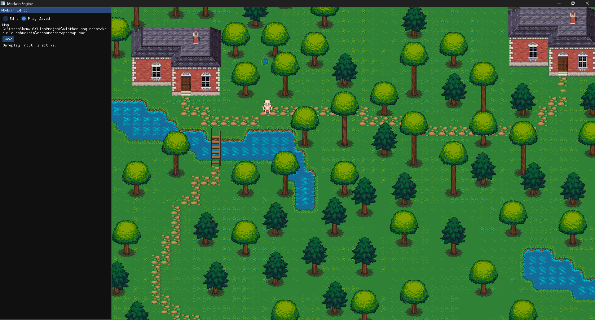
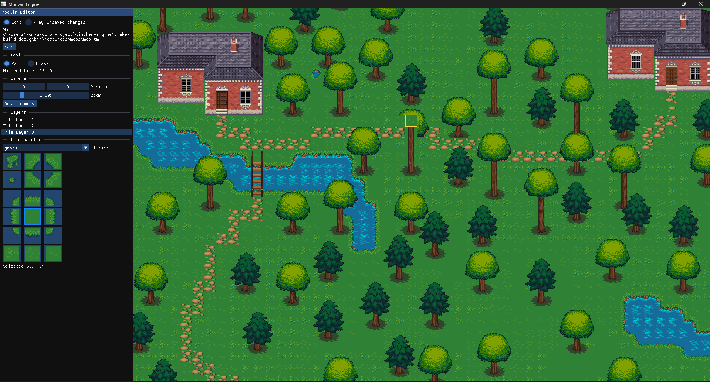

# Modwin Engine

Modwin Engine is a learning-focused 2D game engine, runtime level editor, and game project. The engine runtime is written in C++17; gameplay currently has a native C++ reference implementation behind a versioned, C-compatible API. Engine features are added to support a real playable game, while the game provides practical requirements that guide the engine's architecture.

The current focus is not to build a general-purpose commercial engine. It is to build a small, coherent, efficient engine for one polished 2D game, while preserving a boundary that could later host gameplay written in C#, Java, or another scripting language.

> [!IMPORTANT]
> Modwin Engine is an early working prototype under active development. Its APIs, file handling, gameplay systems, and editor workflow will continue to change.

## Project direction

Development is organized around four near-term goals:

1. **Make the game feel great.** Movement, collision, animation, camera behavior, feedback, and controls should feel deliberate before the project grows in scope.
2. **Make editing an interesting feature.** The live editor should progress beyond basic tile painting into a practical world-building tool with richer brushes, object placement, validation, and undo/redo.
3. **Create a traversable world.** Levels should connect through explicit paths and transitions. This may use a graph of authored levels and portals, or eventually a continuous 2D world with a player-centered camera and streamed regions.
4. **Build a complete game layer.** NPCs, enemies, weapons, shields, health, interaction, inventory, quests, and additional mechanics should turn the engine prototype into a proper game.

Once those foundations are solid, the project may explore deterministic seeded world generation, generated NPC populations, LLM-assisted stories, and machine-learning experiments. These are long-term research directions, not dependencies of the current game.

## Current state

The application opens an SDL3 window, loads a TMX map and its tileset textures, renders an animated player, and runs a custom Dear ImGui editor alongside the game.

### Screenshots
### Play-test mode, running an edited map file


#### Map editing mode


### Engine and game

Implemented foundations include:

- SDL3 window creation, rendering, events, keyboard input, and vertical synchronization
- SDL3_image texture loading from resolved filesystem paths
- A seconds-based frame clock and fixed 60 Hz gameplay simulation
- Separate engine and gameplay CMake targets with no gameplay-to-engine-library dependency
- A versioned C ABI made from fixed-width values, plain structs, function tables, and explicit result codes
- Engine-owned runtime entities accessed by opaque, generation-checked 64-bit handles
- Batched gameplay commands so language-boundary calls do not enter the native engine once per property
- Disposable Play-mode state; stale handles are rejected after entities or the world are cleared
- A single authoritative transform position for each entity
- Kinematic character movement with acceleration, deceleration, and normalized diagonal input
- Correct force accumulation and velocity integration for dynamic rigid bodies
- Per-entity, delta-time-driven animation playback
- Typed, replaceable game-action key bindings and pressed/released input edges
- Runtime logging with spdlog
- Explicit project, asset-root, and active-map paths
- Edit and Play modes with separated editor and gameplay input
- Safe quit handling with an unsaved-changes prompt

The player can currently move and animate, but the game does not yet have collision detection, combat, NPCs, world transitions, or a complete gameplay loop.

### Tile maps and persistence

The map pipeline currently supports:

- Finite orthogonal TMX maps using CSV-encoded tile layers
- Inline tileset parsing with TinyXML2
- Multiple tilesets and multiple tile layers
- Tiled global tile IDs stored as unsigned 32-bit values
- Preservation of Tiled flip flags
- Safe, bounds-checked runtime tile access
- Map metadata, active-document ownership, and dirty-state tracking
- TMX serialization through a temporary file and backup-assisted replacement
- Save/reload round-trip verification in the test suite

### Runtime editor

The editor currently provides:

- A fixed editor sidebar and a dedicated map viewport
- Edit/Play mode switching
- Active-layer selection
- Tileset selection and a visual tile palette
- Paint and erase tools
- Click-and-drag tile painting
- Screen-to-world and world-to-tile coordinate conversion
- Camera position and zoom controls with map-boundary clamping
- A hovered-tile highlight
- Display of the active map path and selected tile GID
- Saving the active TMX map
- Save, discard, or cancel choices when closing a dirty document

The editor is functional, but it is still a first version. It does not yet support undo/redo, object placement, layer visibility, collision painting, level transitions, or advanced brushes.

## Technology

| Component | Purpose |
| --- | --- |
| C++17 | Native engine, editor, and reference game module |
| C-compatible ABI | Language-neutral gameplay boundary |
| CMake | Project configuration and builds |
| SDL3 | Windowing, events, input, and 2D rendering |
| SDL3_image | PNG and image loading |
| Dear ImGui | Runtime editor interface |
| TinyXML2 | TMX parsing and serialization |
| spdlog | Runtime logging |
| Tiled / TMX | Authored map and tileset data |
| CTest | Automated editor and map-persistence tests |

Dear ImGui and its SDL3 renderer backends are vendored under `external/imgui`.

## Project structure

```text
modwin-engine/
|-- include/
|   |-- component/           Reusable animation and movement data
|   |-- core/                Engine lifecycle and project/resource context
|   |-- editor/              Editor state, UI, camera, and controller
|   |-- game/                Native reference game session and controls
|   |-- graphics/            Textures, maps, tile layers, and persistence
|   |-- input/               SDL event and keyboard handling
|   |-- modwin/abi/          Public, C-compatible engine/game contract
|   |-- physics/             Math, transforms, kinematic motion, and rigid bodies
|   |-- runtime/             Engine-owned entities and simulation state
|   `-- time/                Frame timing
|-- src/                     Implementations mirroring include/
|-- tests/                   Coordinate, editing, and TMX round-trip tests
|-- resources/
|   |-- maps/                TMX maps
|   |-- sprites/             Character sprites
|   `-- tiles/               Tileset textures
|-- external/                Vendored third-party source
`-- CMakeLists.txt           Build configuration
```

At a high level, a frame performs the following work:

```text
process SDL and ImGui events
        |
        v
build the editor frame and map viewport
        |
        v
enter/exit disposable runtime Play state when the mode changes
        |
        v
capture game input and submit gameplay commands through the ABI
        |
        v
run zero or more fixed 60 Hz native simulation steps, or update editor tools
        |
        v
render the map viewport and optional gameplay entities
        |
        v
render the ImGui interface and present the frame
```

The active `MapDocument` owns the editable `TileMap`, its source path, and its dirty state. Parsing, editing, rendering, and serialization are separate responsibilities so that maps can be tested without requiring editor input.

`modwin_engine` contains platform, editor, rendering, map, runtime-world, input, timing, and physics infrastructure. `modwin_gameplay` is a native reference client that compiles against only `ModwinGameApi.h`; it does not link to the engine library or include SDL and engine C++ classes. The executable supplies the game function table to the engine.

Across that boundary, gameplay receives input snapshots, creates entities through descriptors, keeps opaque handles, and submits fixed-size command batches. The engine owns memory, physics, animation, rendering, textures, timing, and handle validation. C++ classes, virtual interfaces, STL containers, exceptions, allocators, and SDL types do not cross the ABI. Strings are UTF-8 and borrowed only for the documented call duration.

This is an architectural seam, not a managed runtime integration yet. A future C# host would still need a .NET adapter/host, and Java would need an FFM or JNI adapter. Those adapters should translate managed data to the same C ABI in coarse batches. Per-entity physics and rendering should remain native; crossing the managed/native boundary for every component every frame would undermine both simplicity and performance.

## Building

### Current development environment

The project is developed and tested on Windows using CLion and MinGW. It requires:

- CMake 3.28 or newer
- A C++17 compiler
- SDL3
- SDL3_image
- TinyXML2
- spdlog

`CMakeLists.txt` currently provides machine-specific Windows paths as cache defaults. Override them if your dependencies are installed elsewhere:

```powershell
cmake -S . -B cmake-build-debug `
  -DSDL3_DIR="C:/path/to/SDL3/lib/cmake/SDL3" `
  -DSDL3_image_DIR="C:/path/to/SDL3_image/lib/cmake/SDL3_image" `
  -Dspdlog_DIR="C:/path/to/spdlog" `
  -DMODWIN_TINYXML2_SOURCE_DIR="C:/path/to/tinyxml2"
```

If `MODWIN_TINYXML2_SOURCE_DIR` does not contain TinyXML2 source, CMake falls back to `find_package(tinyxml2 CONFIG REQUIRED)`.

### CLion

1. Open the repository root in CLion.
2. Select a MinGW toolchain with C++17 support.
3. Set the dependency cache variables if the defaults do not match your machine.
4. Reload the CMake project.
5. Build and run the `modwin_game` target.

### Command line

```powershell
cmake -S . -B cmake-build-debug
cmake --build cmake-build-debug --target modwin_game -j 4
```

The debug executable is written to:

```text
cmake-build-debug/bin/modwin_game.exe
```

On Windows, the build copies SDL, MinGW runtime libraries, and `resources/` beside the executable.

## Running and selecting a map

Without arguments, the game opens the copied development map under the executable's `resources/maps/` directory:

```powershell
.\cmake-build-debug\bin\modwin_game.exe
```

To edit the repository's source map instead of the build copy, pass its path explicitly:

```powershell
.\cmake-build-debug\bin\modwin_game.exe ".\resources\maps\map.tmx"
```

The editor displays the resolved active-map path. Always verify that path before saving.

## Controls

### Play mode

| Action | Input | Status |
| --- | --- | --- |
| Move up | W | Implemented |
| Move left | A | Implemented |
| Move down | S | Implemented |
| Move right | D | Implemented |
| Attack | Space | Key binding exists; gameplay is not implemented |

### Edit mode

| Action | Input |
| --- | --- |
| Select a tile | Click a tile in the palette |
| Paint | Select Paint, then left-click or drag over the map |
| Erase | Select Erase, then left-click or drag over the map |
| Select a layer | Click its name in the Layers section |
| Move the editor camera | Edit the camera position in the sidebar |
| Zoom | Use the camera zoom slider |
| Save | Click Save in the sidebar |

ImGui mouse capture prevents clicks on the editor interface from painting the map underneath it.

## Tests

Build and run the current test target with:

```powershell
cmake --build cmake-build-debug -j 4
ctest --test-dir cmake-build-debug --output-on-failure
```

The tests currently cover:

- Screen-to-tile conversion
- Camera-aware coordinate conversion
- Camera bounds and zoom clamping
- Explicit project-context path resolution
- Safe tile mutation
- Detection of no-op tile writes
- TMX parsing
- TMX save/reload equivalence
- Vector length, normalization, and comparison
- Dynamic rigid-body force integration
- Normalized, frame-rate-independent kinematic movement
- Replaceable game-action bindings
- Runtime entity creation, state access, and world clearing
- Opaque runtime-handle generation and stale-handle rejection
- Compilation of the public game API by a C compiler
- Native game-module lifecycle and command submission against a fake ABI host

## Development roadmap

### Phase 1: game feel and engine fundamentals

- Add tile and entity collision detection and resolution to the fixed-step movement foundation
- Add an engine-owned collision-world snapshot when entering Play mode
- Add a player-centered gameplay camera
- Create explicit animation and character state machines
- Add configurable mouse and controller input
- Add debug rendering for collision, coordinates, and movement state
- Add contract tests around the engine/game ABI and command validation
- Establish repeatable gameplay tests where practical

The objective of this phase is a small movement sandbox that already feels responsive and intentional.

### Phase 2: traversable levels and world structure

The first implementation will likely model authored levels as nodes in a graph:

```text
World 1 / Level A ---- Level B ---- Level C
          |                           |
          `-------- Secret D ---------'
```

This requires:

- Stable level and transition IDs
- Doors, exits, portals, and destination spawn points
- A world graph describing legal connections
- Loading and unloading levels
- Preserving per-level entity and interaction state
- A gameplay camera centered around the player
- Validation that every transition references a real destination

A continuous 2D plane with streamed regions remains a possible later direction. It is more flexible, but it requires chunking, streaming, world-coordinate persistence, and broader generation rules. The graph model is a smaller first step that still supports distinct worlds, branching routes, secrets, and backtracking.

### Phase 3: make the editor a real creation tool

- Middle-mouse panning and mouse-wheel zoom
- Layer visibility, locking, reordering, creation, and deletion
- Undo and redo using edit commands
- Rectangle, line, fill, stamp, and multi-tile brushes
- Collision and gameplay-property painting
- Entity, NPC, item, and transition placement
- A visual world-graph and transition editor
- Map validation with actionable error messages
- Open Map, Save As, recent projects, and project configuration
- A dockable render-texture viewport

The editor should eventually support building a playable connected world without manually editing TMX or configuration files.

### Phase 4: proper game systems

- Health, damage, death, and recovery
- Weapons, attack timing, hitboxes, and feedback
- Shields, blocking, stamina, or other defensive mechanics
- Enemies with readable behavior
- NPC schedules, interaction, and dialogue
- Inventory, items, equipment, and pickups
- Quests and persistent world state
- Audio, particles, screen shake, and other game-feel feedback
- Save slots and player progression

### Phase 5: content and polish

- Multiple connected worlds and levels
- Distinct environments and gameplay themes
- Bosses, secrets, shortcuts, and optional routes
- Accessibility and control configuration
- Performance profiling and visible-tile culling
- More automated tests and continuous integration
- Packaging and release builds

## Long-term experiments

Only after the conventional game and editor are reliable, the project may investigate:

- Deterministic worlds generated from seeds
- Chunked or graph-based procedural level generation
- Generated settlements, resources, and NPC populations
- Template-driven procedural quests
- LLM-assisted world history, dialogue, and story proposals
- Optional reinforcement-learning experiments for narrowly defined NPC decisions

The intended architecture is hybrid. Deterministic systems would own gameplay rules, world validity, saves, and repeatability. Generative models could propose constrained narrative content, but the game would validate and store accepted results. Machine learning is considered an experiment, not a replacement for collision, pathfinding, quest state, or conventional NPC behavior.

## Known limitations

- Gameplay movement now has a fixed-step kinematic foundation, but still needs collision and tuning.
- Collision detection and platforming behavior are not implemented.
- Only one development map is currently included.
- The editor viewport uses a fixed sidebar rather than a dockable render target.
- Camera movement is controlled through numeric ImGui controls rather than direct mouse gestures.
- TMX support targets finite orthogonal CSV tile maps and does not preserve every Tiled feature.
- Diagonal Tiled flips are preserved in map data but are not fully rendered.
- There is no undo/redo, entity placement, collision layer, or transition editing.
- The native C++ reference game uses the C ABI, but dynamic module loading and Java/.NET hosts are not implemented.
- ABI version 1 exposes only the small set of operations needed by the current movement prototype.
- The dependency defaults in CMake are still specific to the current Windows development setup.

## Learning goals

This is a first game-engine project, so refactoring is an expected and valuable part of development. Current C++ and architecture priorities include:

- Make ownership and object lifetime explicit.
- Prefer RAII, automatic storage, and `std::unique_ptr` for exclusive ownership.
- Avoid owning raw pointers and manual `new`/`delete` pairs.
- Use const-correct interfaces for read-only operations.
- Keep parsing, runtime state, rendering, and serialization separate.
- Keep gameplay rules independent from editor presentation.
- Keep the public gameplay boundary C-compatible, versioned, and independent of SDL/STL object layouts.
- Use opaque handles and explicit result codes at ownership boundaries.
- Batch managed/native work and keep simulation-heavy loops in the engine.
- Represent levels and transitions with stable data rather than hard-coded paths.
- Design deterministic, testable systems before adding procedural or ML-driven behavior.
- Keep changes small, buildable, and supported by focused tests.

## Status

Modwin Engine is a personal educational project in active development. The live tile editor now provides a usable vertical slice of the intended workflow, while the game itself remains at the movement-prototype stage. The immediate priority is to turn that prototype into a polished, traversable, authored game before expanding into procedural generation or machine-learning research.
